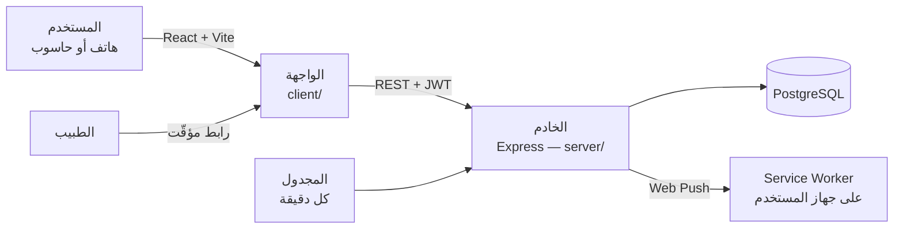
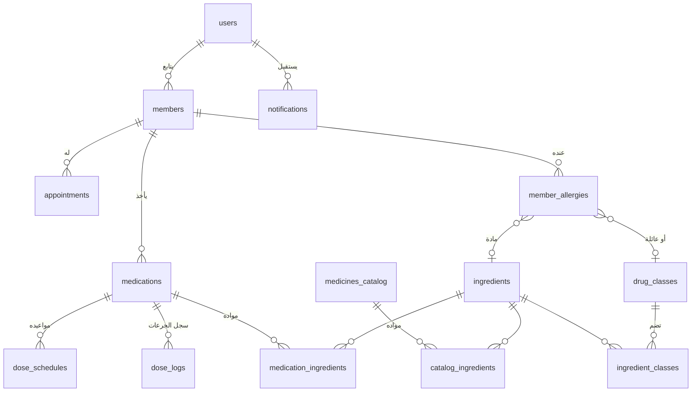

# نبض — متابعة الأدوية والمواعيد

تطبيق ويب عربي لتنظيم أدوية العائلة ومواعيدها الطبية: يذكّر بكل جرعة في وقتها، ينبّه قبل أن ينفد الدواء، يفحص كل دواء جديد مع حساسية الشخص، ويشارك ملفه مع الطبيب برابط مؤقّت.

مشروع تخرج — الجامعة الدولية الخاصة للعلوم والتكنولوجيا.

> **أداة تنظيمية فقط.** نبض لا يشخّص ولا يقترح جرعات ولا بدائل. القرار دائماً للطبيب والصيدلاني.

---

## المزايا

**اليوم والتذكير**
- صفحة «جرعات اليوم»: الجرعة التالية أولاً، وكل الجرعات مقسّمة حسب الفترة (صباح، ظهر، مساء) بلون ثابت لكل فترة.
- إشعارات على الهاتف في موعد كل جرعة، حتى والتطبيق مغلق (Web Push)، وتنبيه هادئ للجرعة المتأخرة.
- تذكير بالمواعيد الطبية مساء اليوم السابق وقبل الموعد بساعتين.
- تقدير لتاريخ نفاد كل علبة، وتذكير صباحي بالأدوية التي تنفد خلال ثلاثة أيام.
- جرس الإشعارات: سجل كل التذكيرات مع عدد غير المقروء، ورنّة حين يصل إشعار والتطبيق مفتوح.

**الأفراد والأدوية**
- ملف لكل شخص: الأدوية، المواعيد، الأمراض المزمنة، والحساسية.
- بحث في كتالوغ ٦٨١٨ دواءً من السوق السوري، بالعربية أو الإنجليزية.
- **فحص الحساسية بالمادة الفعّالة** لا بالاسم (التفاصيل أدناه).
- **تقرير الالتزام**: نسبة الجرعات المأخوذة آخر ٧ أو ٣٠ يوماً، لكل دواء ولكل يوم.
- **تتبّع الكورس**: دواء بمدة محددة (مضاد حيوي ٧ أيام) يُتابَع يوماً بيوم، وينبّه إن بدأت الجرعات تُترك قبل نهايته (التفاصيل أدناه).

**مع الطبيب**
- رابط مؤقّت ورمز QR (يوم، ٣ أيام، أو أسبوع)، للقراءة فقط وبلا حساب.
- الطبيب يرى الحساسية أولاً بشدّتها ونوع التفاعل، ثم الأدوية والالتزام والمواعيد.
- وتقدّم كل كورس جارٍ، والكورسات التي أُوقفت قبل نهايتها آخر ٣٠ يوماً مع اليوم والسبب.
- الأدوية المعلّمة «خاصة» لا تظهر في الرابط أبداً.

**للجميع**
- عربي بالكامل من اليمين إلى اليسار، على الهاتف والحاسوب، ويُثبَّت كتطبيق (PWA).
- «الوضع المريح» لمن يحتاج نصاً أكبر وأزراراً أوسع، ووضع داكن، واحترام إعداد «تقليل الحركة».

---

## كيف يعمل فحص الحساسية

الدواء نفسه تبيعه شركات كثيرة بأسماء تجارية مختلفة (ASITAMOL و ACETALGIN كلاهما باراسيتامول)، فمقارنة الأسماء لا تكفي. لذلك يُحوَّل كل شيء إلى **مواد فعّالة** مرة واحدة، ويصير الفحص مقارنة أرقام:

1. **تنظيف الكتالوغ** (`server/ingredients.js`): نص المادة الحر («R.TAB. TRAMADOL HCL») يصير مادة موحّدة (TRAMADOL)، فتُحذف بقايا الشكل الصيدلاني والأملاح، وتُصحَّح الأخطاء الإملائية، وتُفصل الأدوية المركّبة. النتيجة: ٥٩٣ مادة، وكل صف من الكتالوغ مربوط بمواده.
2. **عائلات الأدوية** (`server/drugClasses.js`): ١٩ عائلة مهمّة في الحساسية حسب تصنيف ATC لمنظمة الصحة العالمية (البنسلينات، السيفالوسبورينات، مضادات الالتهاب...)، كل منها تذكر موادها بالاسم صراحةً، مع جدول التحسّس المتصالب بين العائلات.
3. **حساسية الفرد** صفوف منظّمة: مادة أو عائلة، مع الشدّة ونوع التفاعل. ما لا يوجد في الكتالوغ يُحفظ نصاً ويُعلَّم بوضوح «لا يُفحص».
4. **الفحص** (`server/allergy.js`) تقاطع مجموعات، بأربعة مستويات من الأخطر:

| المستوى | المعنى | مثال |
|---|---|---|
| المادة نفسها | الدواء يحتوي المادة المسجّلة | حساسية IBUPROFEN ← BRUFEN |
| العائلة | الحساسية من العائلة كلها | البنسلينات ← AUGMENTIN |
| تحسّس متصالب | المادة من عائلة المادة المسجّلة | IBUPROFEN ← DICLOFENAC |
| تحسّس متصالب منخفض | عائلتان بينهما تحسّس معروف | البنسلينات ← CEFUROXIME |

الفحص يعمل في الاتجاهين: عند إضافة دواء، وعند إضافة حساسية لشخص يأخذ دواءً متعارضاً أصلاً. كل تأكيد «الطبيب يعلم» يُسجَّل (من، ومتى، وعلى ماذا). ودواء بلا مواد معروفة لشخص عنده حساسية لا يُحفظ إلا بتأكيد صريح أنه لم يُفحص.

## تقرير الالتزام

`server/adherence.js` يحسب الجرعات **المستحقة** من جدول مواعيد كل دواء بين تاريخ بدئه وإيقافه، يوماً بيوم، ويقابلها بالجرعات **المؤكَّدة**. الجرعة التي حان موعدها خلال الساعة الأخيرة لا تُحسب فائتة بعد، و«في وقتها» تعني التأكيد خلال ساعة من الموعد.

## تتبّع الكورس

في استبيان لـ٢٥ صيدلانياً، أكثر مشكلة تكررت (٢٠ من ٢٥) هي أن المريض **يوقف الدواء قبل نهاية الكورس**، وهي أكثر من نسيان جرعة (١١ من ٢٥). التذكير بالجرعات وحده لا يحلّها، لأن التطبيق لم يكن يعرف أن للدواء نهاية.

- **الكورس** دواء له مدة محددة يُختار صراحةً في نموذج الدواء («كورس بمدة محددة» وعدد الأيام). `end_date` هو النهاية المخطّطة، و`stopped_on` و`stop_reason` متى أُوقف فعلاً ولماذا، فلا يختلط «انتهى» بـ«أُوقف مبكراً».
- `server/course.js` يحسب لكل كورس: اليوم الذي وصل إليه من أصل كم، والجرعات المأخوذة من المخطّطة، وما بقي، والحالة: جارٍ، آخر يوم، مكتمل، أو أُوقف مبكراً.
- **في خطر**: آخر جرعتين مستحقتين لم تُؤخذا والكورس لم ينتهِ. هكذا يبدأ التوقف الصامت، فيُلتقط قبل أن يصير توقفاً.
- **في التطبيق**: خانة لكل يوم من الكورس في ملف الفرد، و«يوم ٤ من ٧» بجانب الجرعة، وبطاقة «الكورسات» في صفحة اليوم، وإشعار صباحي (١٠:٠٠) للكورسات في خطر أو في يومها الأخير.
- **الإيقاف قبل النهاية** يعرض ما بقي ويسأل عن السبب (بقرار الطبيب، أعراض جانبية، شعر بتحسّن، سبب آخر). الإيقاف ممكن دائماً، فالتطبيق يذكّر ولا يقرّر.

---

## البنية





| المجلد / الملف | الدور |
|---|---|
| `client/src/pages` | صفحات التطبيق (اليوم، العائلة، الملف، الطبيب...) |
| `client/src/styles` | المتغيّرات والهوية (فيروزي + كريمي، الوضع المريح، الوضع الداكن) |
| `server/routes` | واجهة الخادم البرمجية |
| `server/allergy.js` · `ingredients.js` · `drugClasses.js` | فحص الحساسية |
| `server/adherence.js` | تقرير الالتزام |
| `server/course.js` | تقدّم الكورس: اليوم، الجرعات، «في خطر»، والإيقاف المبكر |
| `server/push.js` | المجدول والإشعارات وسجلها |
| `server/security.js` | ترويسات الأمان، العناوين المسموح لها، وحدّ المحاولات |
| `server/migrate.js` | تحديثات قاعدة البيانات عند كل تشغيل — لا SQL يدوي بعد السحب |
| `database/` | إنشاء الجداول وكتالوغ الأدوية |

---

## التشغيل

الخطوات الكاملة لجهاز جديد في [SETUP.md](SETUP.md). باختصار:

```bash
# الخادم
cd server
npm install
npm run dev          # المنفذ 5000 — يحدّث قاعدة البيانات تلقائياً عند التشغيل

# الواجهة (طرفية ثانية)
cd client
npm install
npm run dev          # http://localhost:5173
```

### بيانات العرض

```bash
cd server
npm run seed:demo
```

ينشئ حساباً تجريبياً جاهزاً (يُعاد من الصفر في كل تشغيل، ولا يلمس أي حساب آخر): ثلاثة أفراد بحساسية منظّمة، سبعة أدوية من الكتالوغ الحقيقي، شهر من سجل الجرعات، مواعيد وإشعارات. البريد وكلمة المرور تطبعهما الأداة في النهاية، وهما في أول ملف `server/scripts/seed-demo.js`.

### الاختبارات

```bash
cd server
npm test
```

٤٠ اختباراً على الكتالوغ وقاعدة البيانات الحقيقيين: توحيد أسماء المواد، أزواج حساسية ودواء معروفة (ومنها حالات **يجب ألا** تُنبّه)، والحساسية المضافة بعد الدواء، وتقرير الالتزام، وحالات الكورس (جارٍ، في خطر، آخر يوم، مكتمل، أُوقف مبكراً).

---

## الأمان والخصوصية

- كلمات المرور مشفّرة (bcrypt)، والجلسة توكن JWT صالح سبعة أيام.
- كل طلب يتحقق أن الفرد أو الدواء يخصّ المستخدم نفسه.
- ترويسات أمان قياسية (helmet)، والخادم لا يجيب إلا واجهات التطبيق نفسه (CORS).
- حدّ للمحاولات: ١٠ محاولات دخول كل ربع ساعة، و٣٠ طلباً في الدقيقة على صفحة الطبيب العامة.
- روابط الطبيب عشوائية طويلة، مؤقّتة، وللقراءة فقط، والأدوية الخاصة لا تظهر فيها.
- الخادم لا يقبل طلبات أكبر من ١٠٠ كيلوبايت.

## حدود معروفة

- **فحص الحساسية بقدر بيانات الكتالوغ**: الحساسية من المواد غير الفعّالة (اللاكتوز، الأصبغة) غير مسجّلة فيه فلا تُفحص، وكذلك الأدوية غير الموجودة فيه.
- **التداخلات الدوائية** (دواء مع دواء) غير مفحوصة: تحتاج مصدر بيانات مرخّصاً. عمل مستقبلي.
- **الأسماء العربية في الكتالوغ** نقل صوتي آلي للبحث، لا ترجمة طبية.
- **تقرير الالتزام** يعتمد على تأكيد المستخدم بنفسه، لا على سجل طبي؛ وتعديل أوقات دواء يُحسب به الماضي أيضاً.
- **النسخة المنشورة على GitHub Pages** تعرض الصفحة التعريفية فقط؛ التطبيق يحتاج الخادم وقاعدة البيانات.

---

## الفريق

وسيم نصر · دارين النجم · بيسان أبو شهلا
